# Kalmia Blabla — clavier vocal Android

> **Kalmia Blabla** — un clavier vocal conçu au Québec, pour le français d'ici.
> Votre voix est transcrite sur votre téléphone : elle n'est envoyée à personne.
> Pas de compte, pas de publicité, pas de télémétrie, et un code source public
> que chacun peut lire et vérifier.

Kalmia Blabla est un clavier Android (IME) dont la seule fonction est la
dictée vocale. Il est développé au Québec. La transcription tourne
**entièrement sur le téléphone** avec
[sherpa-onnx](https://github.com/k2-fsa/sherpa-onnx) : par défaut, ni l'audio ni
le texte ne quittent l'appareil, et le réseau ne sert qu'à télécharger les
modèles. Deux exceptions, toutes deux de votre seul choix : le « Serveur distant »
(un serveur que vous choisissez et hébergez vous-même, voir plus bas), et le
partage volontaire d'une lecture du test de lecture, par un courriel que vous
envoyez vous-même depuis votre messagerie (voir « Test de lecture en français
québécois ») ; l'application elle-même n'envoie rien.
Spécification : issue #10 ; positionnement et marque : issue #15. Choix de
développement : [`DECISIONS.md`](DECISIONS.md).

Ce n'est pas un clavier de frappe : on garde son clavier habituel et on
bascule vers celui-ci pour dicter.

## Ce que l'application apporte

| Plus-value | Ce qui la rend vraie |
|---|---|
| **La voix reste sur le téléphone** | La transcription est faite par un modèle exécuté sur l'appareil ; le réseau ne sert qu'à télécharger les modèles. Fonctionne hors ligne une fois un modèle installé. |
| **Aucun compte, aucune collecte** | L'application ne demande aucun compte et n'a ni publicité ni télémétrie. Rien n'est envoyé par défaut. Le partage d'une lecture du test est un courriel que vous envoyez vous-même, après un consentement explicite. |
| **Pensée pour le français québécois** | « Français (Québec) » est présélectionné ; le modèle recommandé a été mesuré sur des voix « Français du Canada » (voir « Vos langues et le modèle recommandé »). |
| **Transparente et vérifiable** | Code source public dans ce dépôt (sans fichier de licence pour l'instant : chacun peut le lire, mais ce n'est pas encore un logiciel libre au sens juridique) ; chaque modèle est nommé avec son éditeur et sa licence ; chaque fichier téléchargé est vérifié par somme de contrôle SHA-256. |
| **Sous votre contrôle** | Vous choisissez le modèle, les langues et, si vous le voulez, un serveur personnel. |
| **Développée au Québec** | Affirmation de l'auteur. |

**Origine des modèles.** Les modèles ne sont pas québécois : Parakeet vient de
NVIDIA, Qwen3-ASR d'Alibaba, Whisper d'OpenAI (et sa variante affinée sur le français québécois, de
ele-sage, une personne de la communauté), et le petit LLM facultatif de
nettoyage du texte (désactivé par défaut) passe par MediaPipe, une
bibliothèque de Google. La souveraineté offerte porte sur les **données** (la
voix reste sur le téléphone par défaut) et sur le **logiciel** (code public,
conçu ici), pas sur l'origine des modèles. Ce n'est pas une application
« 100 % québécoise ».

## Pourquoi pas la saisie vocale de Google ?

Cette section décrit ce que fait **cette application**. Elle ne dit pas ce que
fait la saisie vocale de Google : où son traitement a lieu varie selon la
fonction, comme le montre l'aide de Gboard (premier lien ci-dessous), et nous
n'avons pas cherché à le mesurer. Les deux seules affirmations sur Google
portent un lien vers une source officielle, lue le 2026-11-12.

- **Ici, la transcription se fait sur le téléphone, par un modèle que vous
  avez téléchargé et que vous choisissez.** Aucun compte n'est demandé, et le
  code qui le fait est dans ce dépôt, où chacun peut le lire. Un serveur
  n'intervient que si une adresse de « Serveur distant » est configurée **et**
  que vous choisissez le mode « serveur » (à l'installation ou dans les Réglages).
- **Chez Google, l'endroit du traitement dépend de la fonction.** Sur la page
  d'aide de Gboard
  [« Utiliser les fonctionnalités avancées de saisie vocale »](https://support.google.com/gboard/answer/11197787?hl=fr),
  la saisie vocale avancée indique : « Le texte dicté est conservé sur votre
  appareil. », tandis que, pour les modifications détaillées par commande
  vocale, « la transcription de votre commande vocale et le texte du champ de
  saisie sont envoyés aux serveurs Google » (la page ajoute « Aucune donnée
  audio n'est envoyée. »). Ce que fait votre téléphone dépend donc de la
  fonction utilisée ; consultez cette page et les réglages de votre appareil.
- **La politique de confidentialité de Google** (
  [policies.google.com/privacy](https://policies.google.com/privacy?hl=fr),
  version « À compter du 16 octobre 2026 ») est celle de ses services en
  général : sous « Informations collectées par Google », « Votre activité », elle
  cite parmi les informations recueillies les « Contenus multimédias (comme des
  images, des fichiers, des contenus audio et des vidéos) issus de vos
  interactions ». Elle ne dit pas, à cet endroit, que la saisie vocale en
  fait partie ; lisez-la pour savoir ce qui s'applique à votre usage.

Nous n'affirmons rien d'autre sur Google : ni précision, ni vitesse, ni
mode hors ligne, ni usage publicitaire de la voix, faute de source officielle
lue qui le dise. Si vous voulez comparer, le test est simple : dictez la même
phrase avec les deux et jugez le texte.

## Vos langues et le modèle recommandé

Sur l'écran de configuration, l'étape **« 3. Vos langues »** propose onze
langues en cases à cocher : français (Québec), français (France), anglais,
mandarin, hindi, espagnol, arabe, bengali, portugais, russe et ourdou.
« Français (Québec) » est présélectionné et il reste toujours au moins une
langue cochée. Le choix se modifie aussi dans les Réglages. Il sert à :

- **recommander un modèle** : la carte du modèle recommandé porte le badge
  « Recommandé pour vos langues » et une phrase de raison. Un modèle qui ne
  couvre pas une langue cochée affiche un avertissement écrit ; rien n'est
  bloqué, tous les modèles restent téléchargeables ;
- **régler la langue des moteurs** : avec une seule langue (Québec et France
  comptent pour `fr`), Whisper local, Qwen3-ASR et le serveur distant la
  reçoivent ; avec plusieurs, la langue est détectée automatiquement.
  Parakeet ne prend aucune langue (sherpa-onnx 2.0.1 n'a pas d'entrée pour
  elle) : il la devine, ce qui peut mal tourner sur un mot dicté seul.

La table de recommandation (`stt/ModelRecommendation.kt`) se lit de haut en
bas : Parakeet si toutes vos langues font partie de ses 25 langues
européennes ; sinon Qwen3-ASR s'il les couvre toutes ; sinon Whisper. La
couverture vient des fiches des modèles (détail et sources dans `DECISIONS.md`).
Bengali et ourdou ne sont couverts que par Whisper, et « couvert » ne veut pas
dire « bien transcrit ».

**Mesure en français québécois, et ses limites.** Six courts extraits Common
Voice 22.0 (CC0) portant l'accent déclaré « Français du Canada », 59 mots au
total, ont été transcrits par chaque modèle sur l'ordinateur de la CI :

| Modèle | Mots erronés sur 59 |
|---|---|
| Parakeet TDT 0.6b v3 | 6,8 % |
| Whisper large-v3-turbo | 10,2 % |
| Qwen3-ASR 0.6B | 13,6 % |

C'est un indice, pas une preuve : l'échantillon est minuscule (un seul clip
fait échouer les trois modèles) ; une des erreurs de Whisper est un artefact de
notation (« 18 » contre « dix-huit ») ; le champ d'accent « Français du
Canada » ne distingue pas le Québec des autres provinces ; **personne n'a
encore écouté ces six extraits** ; les phrases viennent de Wikipédia et de
romans, donc la mesure porte sur l'accent et non sur le vocabulaire d'ici ; et
elle n'a pas été faite sur un téléphone. La recommandation le dit : « mesuré
sur six courts extraits (59 mots) : un indice, pas une preuve ». Vous pouvez refaire la mesure avec votre propre voix
dans **Comparer les modèles**.

## Test de lecture en français québécois

Si « Français (Québec) » fait partie de vos langues, une carte « Aider à
améliorer la dictée en français québécois » apparaît à la fin de la configuration
(« Non merci » la masque sur l'écran principal ; elle reste dans les Réglages).
Le test se déroule ainsi :

1. **Une question d'abord** : « Parlez-vous un français québécois ? ». Répondre
   *non* termine tout : un mot de remerciement, aucun test, aucun enregistrement,
   aucun fichier, et la carte n'est plus proposée. La réponse reste sur le
   téléphone et se corrige dans les Réglages (section « Test de lecture en
   français québécois »).
2. **Acceptation** : le test se fait sur le téléphone ; rien n'en sort.
3. **Lecture** : un texte d'environ 220 mots, un paragraphe à la fois, en grands
   caractères. Un bouton enregistre puis arrête (20 secondes au plus par
   paragraphe) ; on peut refaire un paragraphe, revenir en arrière ou demander
   le score avant la fin.
4. **Score** : chaque paragraphe est transcrit par le ou les modèles installés
   (un seul suffit ; le serveur distant n'est jamais utilisé), puis comparé au
   texte. L'écran donne le taux de ressemblance (1 − taux d'erreur de mots) global
   et par paragraphe, pour chaque modèle, avec les mots mal compris surlignés **et
   soulignés** dans le texte. Si un autre modèle installé vous comprend nettement
   mieux, l'écran le dit et propose de le choisir.

5. **Partage, seulement si la dictée vous a mal compris** : si le taux d'erreur
   dépasse 20 % avec le modèle recommandé pour vos langues, sur le texte complet,
   l'écran du score propose de partager votre lecture. Sous ce seuil, rien n'est
   proposé. La proposition montre **exactement ce qui partirait**, élément par
   élément et avec ses valeurs : l'audio (un fichier WAV 16 kHz par paragraphe),
   le texte lu et sa version, la transcription et le score du modèle recommandé
   (pas ceux des autres modèles), le nom du modèle, la version de l'application,
   le modèle du téléphone, la déclaration « je parle un français québécois », la
   date (le jour seulement) et, si vous l'écrivez, votre région. Aucun
   identifiant, aucune autre dictée, aucun réglage. On peut réécouter, refaire le
   test ou refuser.
6. **Consentement, puis fichier** : rien n'est créé tant que la case « J'ai lu ce
   qui précède et j'accepte de partager ma lecture » (non cochée au départ) n'est
   pas cochée **et** que « Préparer le courriel » n'est pas touché. Le fichier (une
   archive zip : `contribution.json` et les WAV) est alors écrit dans l'espace privé
   de l'application.
7. **Envoi par vous** : « Envoyer par courriel » ouvre votre messagerie avec le
   destinataire (`remi@kalmia.ca`), un objet, un court message et le fichier joint ;
   c'est vous qui appuyez sur « Envoyer », ou qui annulez. « Partager le fichier
   autrement » ouvre le sélecteur de partage du système. Le courriel montre au
   destinataire votre adresse de courriel.
8. **Suppression** : le fichier est supprimé par « Supprimer le fichier », par
   « Ne pas partager », par « Refaire le test » et quand l'écran du test se ferme ;
   un fichier laissé par une application arrêtée de force est supprimé à
   l'ouverture suivante du test, ou au démarrage de l'application s'il a plus
   d'un jour. Ce qui a été envoyé, lui, est conservé par le destinataire (deux ans
   au plus) selon la politique.

Pendant le test, l'enregistrement reste en mémoire et disparaît quand l'écran se
ferme : aucun fichier n'est écrit sans le consentement de l'étape 6. Ni le test
ni le partage ne font de requête réseau, et aucune permission n'a été ajoutée
(le micro est déjà demandé ; l'archive est remise à la messagerie par un
`FileProvider` limité au dossier des archives, avec une permission de lecture
pour la seule application choisie). Politique de contribution :
[`docs/CONTRIBUTION.md`](docs/CONTRIBUTION.md) ; textes, seuils et choix :
`DECISIONS.md` (« Issue #15, lot 4 »).

| Score par modèle (clair) | Score (sombre) | Proposition de partage (clair) | Partage (sombre) |
|---|---|---|---|
| 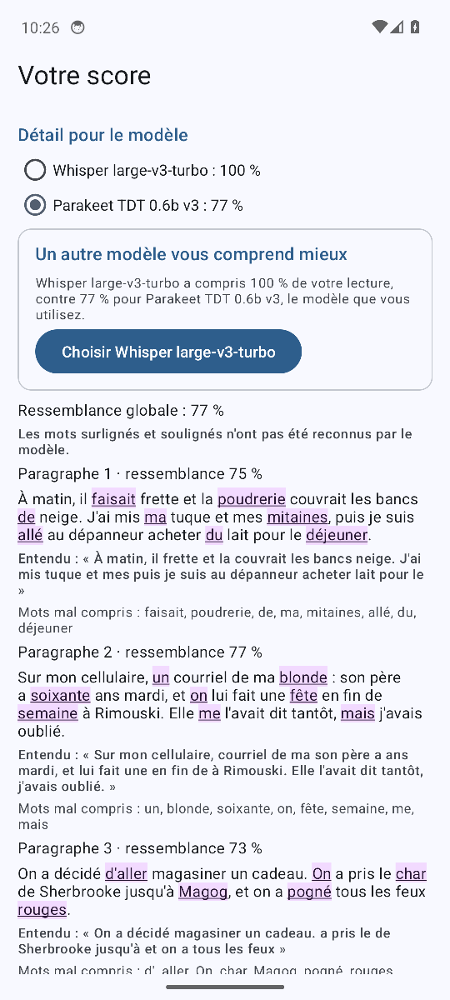 | 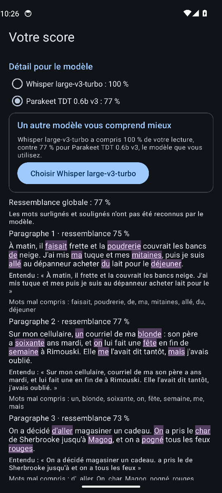 | 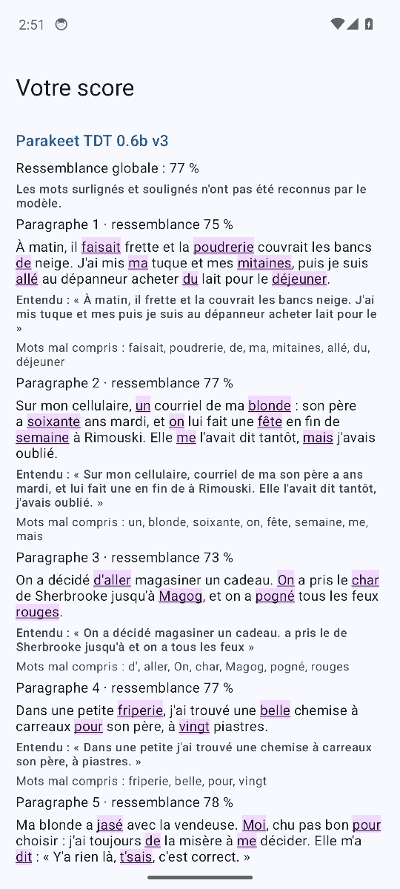 | 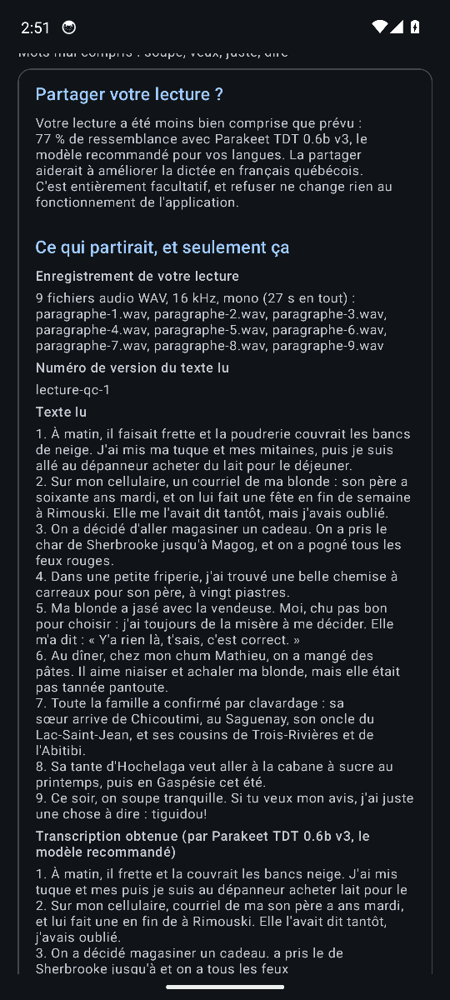 |

## Apparence

L'interface est un thème Material 3 générique : bleu, polices du système,
coins arrondis et ombres ordinaires de Material. Le thème suit le réglage
Système, Clair ou Sombre, sur les écrans comme sur le clavier. L'erreur reste en
rouge et s'accompagne toujours d'un texte ou d'une icône ; le micro devient
rouge à l'écoute.

## Aperçu

Captures prises automatiquement par la CI sur un émulateur Pixel 6
(`ScreenshotTest`) ; le texte vient d'un moteur de test, pas d'un modèle.
Chaque écran existe en clair (`-light`) et en sombre (`-dark`).

| Clavier prêt | À l'écoute | Texte inséré |
|---|---|---|
| 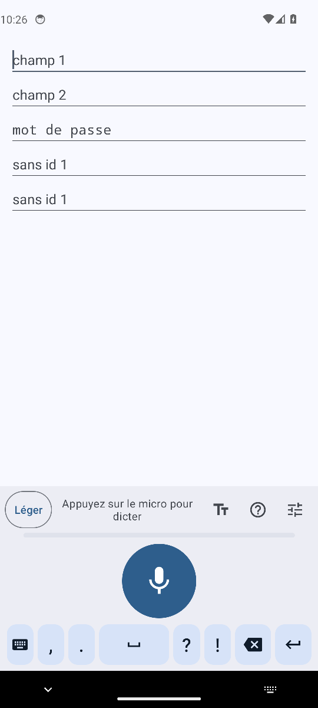 | 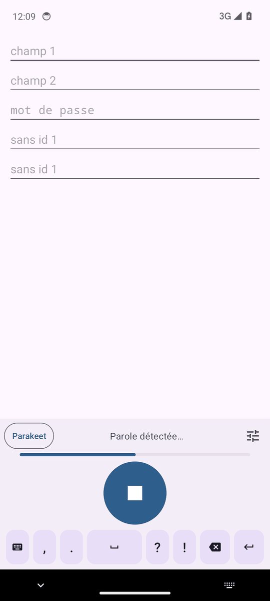 | 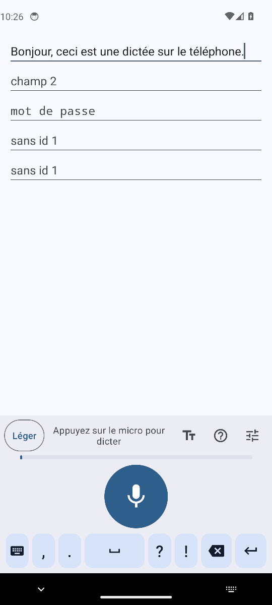 |
| 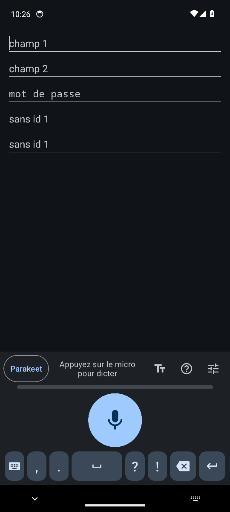 | 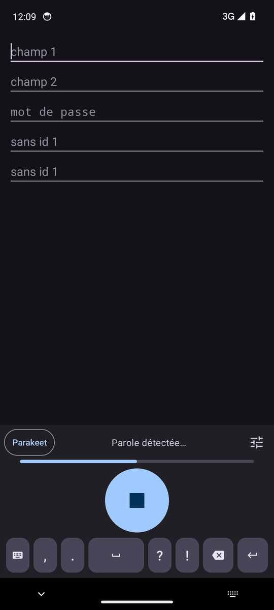 | 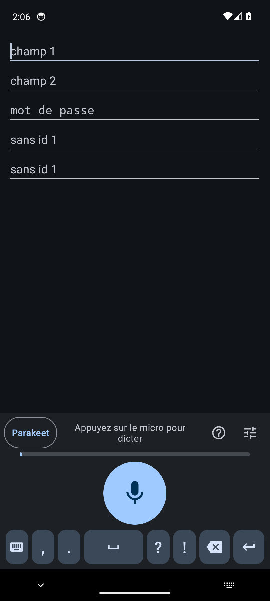 |

Configuration (accueil et étapes ; « Vos langues » ; modèle recommandé avec son badge) :

| Accueil | Vos langues | Modèles |
|---|---|---|
| 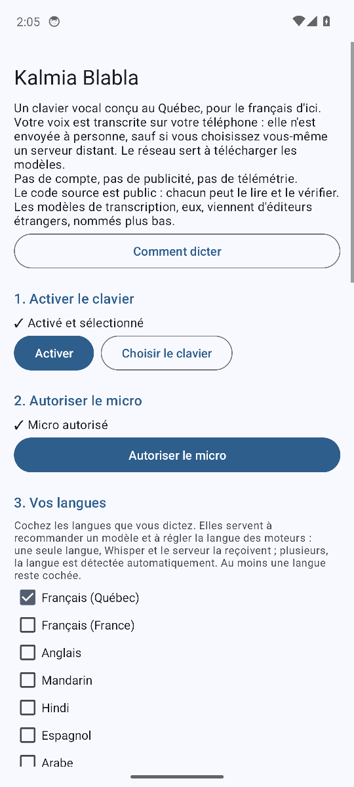 | 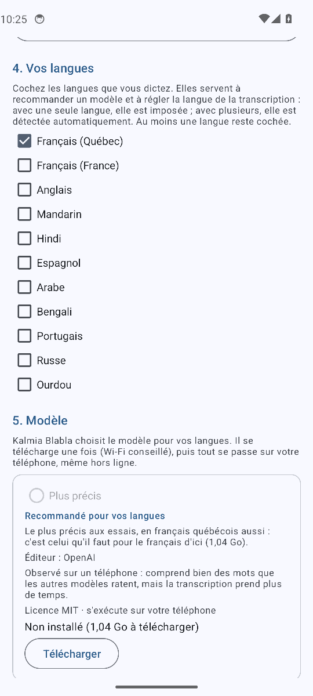 | 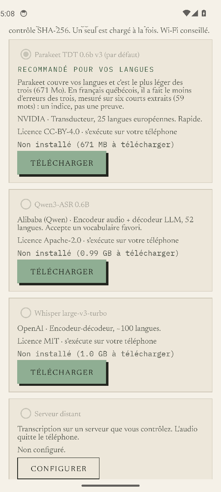 |
| 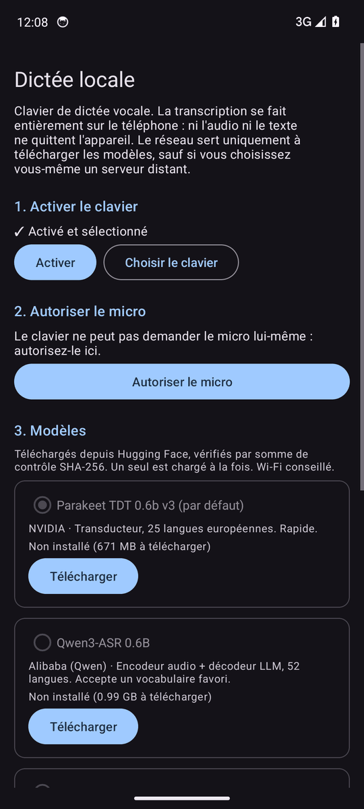 | 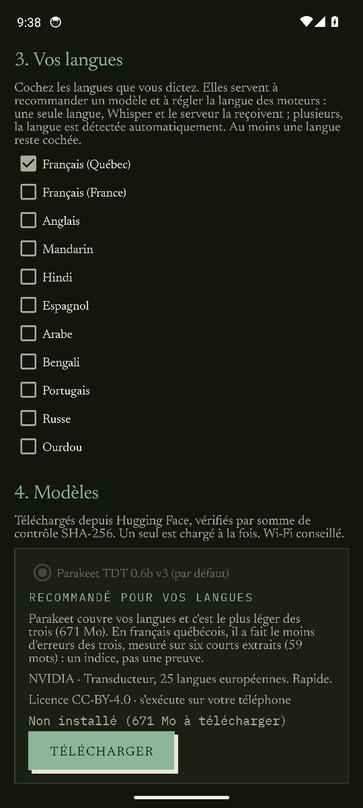 | 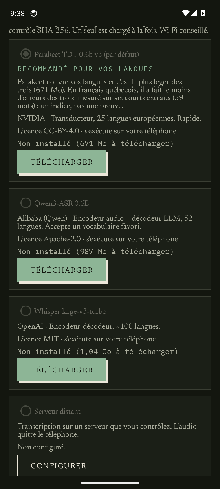 |

| Réglages | Comparaison des modèles | Diagnostic serveur |
|---|---|---|
| 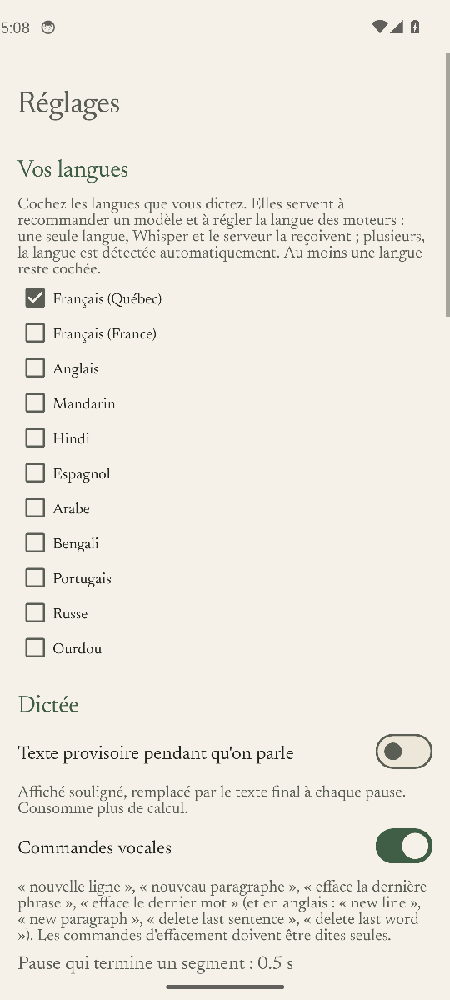 | 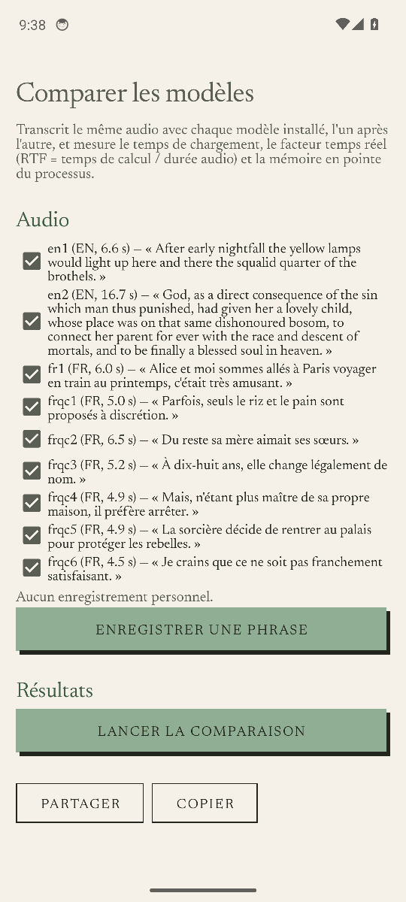 | 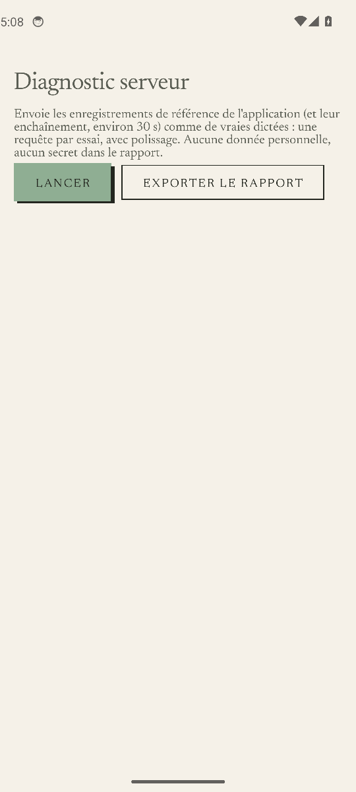 |
| 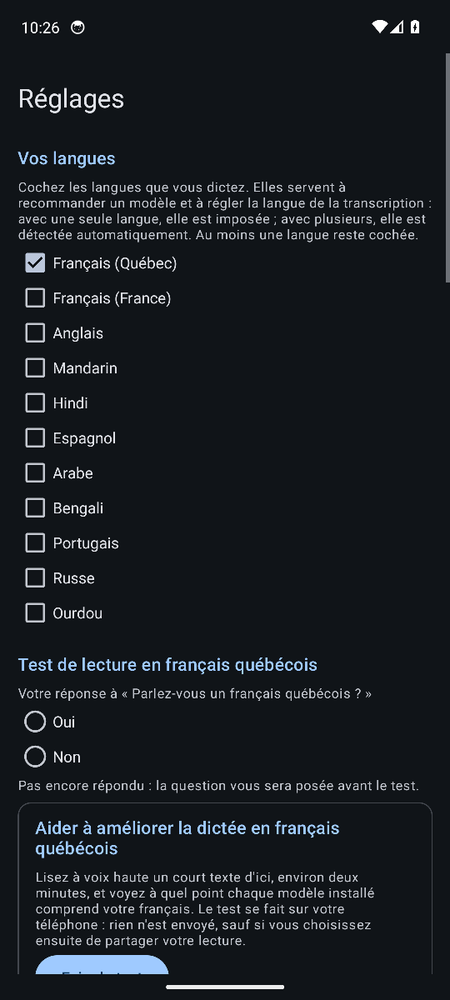 | 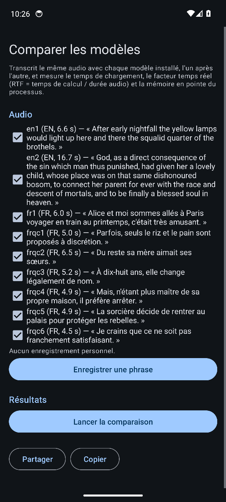 | 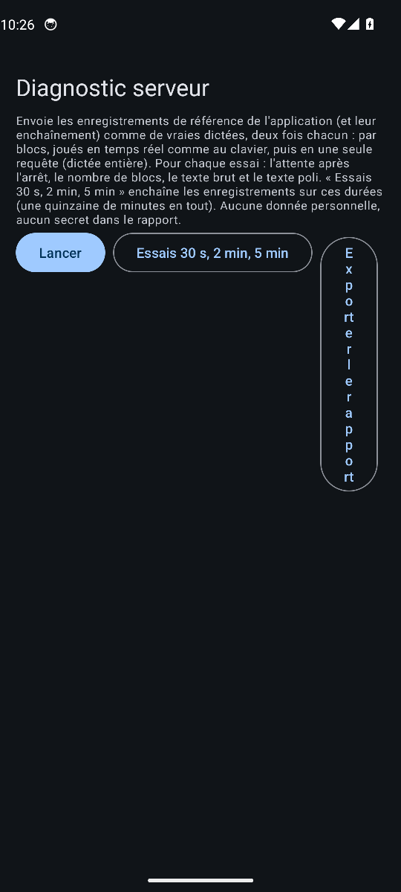 |

## Installation

1. Télécharger l'APK de la dernière release `android-v…` du dépôt sur le
   téléphone et l'ouvrir (autoriser l'installation depuis cette source).
   Les releases sont signées avec la clé privée du projet : une nouvelle
   version s'installe par-dessus l'ancienne, et un APK signé par quelqu'un
   d'autre est refusé comme mise à jour.
2. Ouvrir **Kalmia Blabla** :
   - « Activer » le clavier « Kalmia Blabla (voix) » dans les réglages Android ;
   - « Autoriser le micro » (un clavier ne peut pas demander la permission lui-même) ;
   - cocher vos langues (étape « Vos langues ») : le modèle recommandé est mis en avant ;
   - télécharger au moins un modèle (Wi-Fi conseillé, 0,7 à 1 Go chacun).
3. Dans n'importe quelle application, basculer vers le clavier Kalmia Blabla
   (icône clavier de la barre de navigation, ou touche micro de votre clavier
   habituel) et appuyer sur le micro. Appuyer de nouveau pour arrêter.

## Le clavier

- Gros bouton micro : appui pour démarrer, appui pour arrêter. Le texte
  s'insère à chaque pause.
- Bouton du modèle (en haut à gauche) : changer de modèle sans quitter le champ.
- Touches : clavier précédent, `,` `.` espace `?` `!`, effacer (maintenir pour
  répéter), entrée.
- Commandes vocales : voir « Dicter la ponctuation » ci-dessous.
- Désactivé dans les champs de mot de passe.

## Dicter la ponctuation

**La commande est le nom du signe**, tel qu'on le dirait à quelqu'un : pas de
mot d'activation à apprendre. Les formulations sont celles des dictées d'Apple
et de Google, pour qu'une habitude prise ailleurs fonctionne ici.

| Vous dites | Vous obtenez |
|---|---|
| « deux-points » (colon) | `:` |
| « point-virgule » (semicolon) | `;` |
| « point d'interrogation » (question mark) | `?` |
| « point d'exclamation » (exclamation mark) | `!` |
| « ouvrir les guillemets » / « fermer les guillemets » (open quote / end quote) | « … » en français, “…” en anglais |
| « ouvrir la parenthèse » / « fermer la parenthèse » (open parenthesis / close parenthesis) | `(` `)` |
| « nouvelle ligne » (new line) | retour à la ligne |
| « nouveau paragraphe » (new paragraph) | ligne vide |
| « efface la dernière phrase », « efface le dernier mot » (delete last sentence / word) | efface ce qui précède |

Exemple : « il a dit deux-points ouvrir les guillemets bonjour fermer les
guillemets » donne `Il a dit : « bonjour »`. Les variantes courantes sont
acceptées (« ouvrez les guillemets », « guillemet ouvrant », « à la ligne »…).
La liste complète et à jour est celle de l'écran « Comment dicter », généré
depuis la même table que l'analyse (`CommandTable`) : l'aide ne peut pas
diverger du comportement.

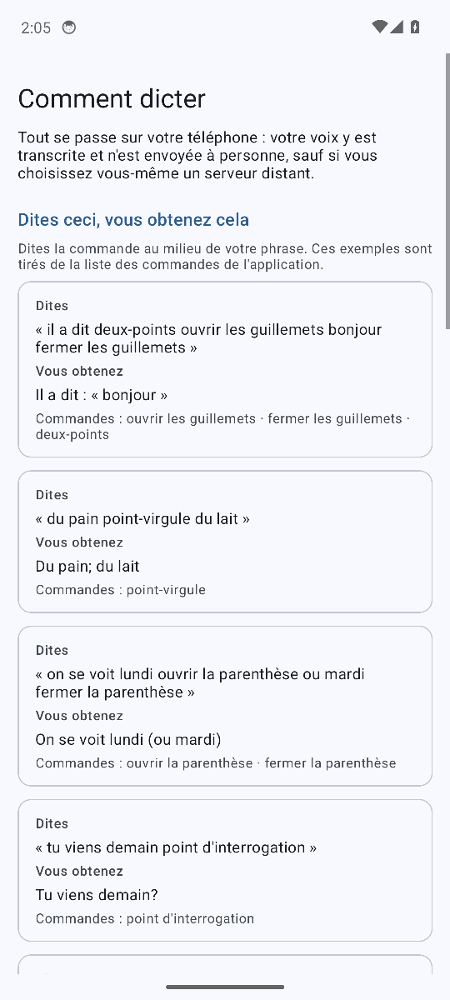
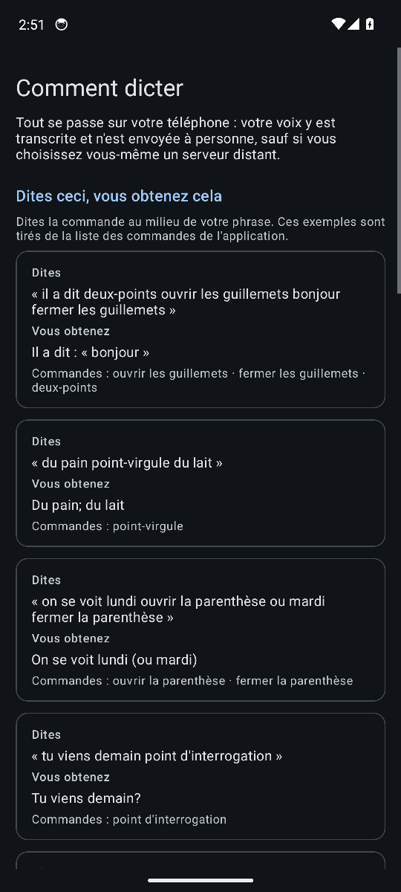

L'écran « Comment dicter » s'ouvre à la fin de la configuration ; on le rouvre
depuis l'écran principal et depuis le bouton d'aide du clavier.

- **Peu de faux positifs.** Une formulation n'est une commande que si les mots
  autour n'en font pas du texte ordinaire : « j'ai marqué deux points » ou
  « c'est un point d'interrogation pour moi » restent du texte. Dans le doute,
  le texte reste tel quel.
- **Jamais de doublon.** Si le modèle a déjà mis un signe là où vous en dictez
  un, il n'en reste qu'un. La virgule et le point, que les modèles placent déjà
  bien, ne sont pas dans la liste.
- **Typographie selon la langue** (seuls les signes dictés sont touchés).
  Québec (OQLF) : espace insécable avant `:` et dans les guillemets, rien avant
  `;` `?` `!`. France : espace insécable aussi avant `;` `?` `!`. Anglais :
  aucune espace, guillemets “…”. « Français (France) » choisi sans « Français (Québec) » donne la typographie
  de France ; dans les autres cas, celle du Québec.
- **Langues** : les commandes de ponctuation suivent les langues choisies
  (français, anglais, ou les deux). Avec d'autres langues seulement, seules la
  mise en forme et les effacements restent actifs. Le réglage « Commandes
  vocales » les coupe toutes.

Limites connues :

- « deux points » sans trait d'union, suivi d'un mot ordinaire (même après une
  virgule), n'est pas reconnu ; une commande coupée par une pause en deux
  segments non plus.
- Une commande dite en tête de phrase et suivie d'une virgule reste une
  commande : « Ouvrez les guillemets, s'il vous plaît » donne `« S'il vous
  plaît`. On ne peut pas la distinguer de « Ouvrez les guillemets, bonjour… ».
- Les heures (« 13 deux-points 52 » → `13:52`) ne sont collées que dites d'un
  seul souffle.
- Le texte provisoire (pendant la parole) montre les mots dits ; la commande
  s'applique au texte final.
- **Mode serveur.** Les commandes s'appliquent au texte reçu du serveur, comme
  à celui d'un modèle local. Avec le polissage du serveur (dictée entière), son
  modèle de langage peut remplacer lui-même une commande par le signe, avec ses
  propres espaces (une espace ordinaire avant `: ? ! ;`, sans la typographie du
  Québec), ou la laisser telle quelle ; dans les deux cas il n'y a pas de
  doublon. Le garde-fou du serveur rejette en général une réponse où des mots
  ont disparu, et c'est alors le texte brut qui est utilisé, mais pas toujours
  (une dictée longue avec « point d'exclamation » ou « nouvelle ligne » au
  milieu peut passer). Pour des signes toujours typographiés comme ici, utilisez
  un modèle du téléphone, ou une API compatible OpenAI (sans polissage).

## Modèles

| Modèle | Éditeur | Taille (int8) | Affichage (issue #22) |
|---|---|---|---|
| Whisper large-v3-turbo (défaut) | OpenAI | 1,04 Go | Toujours proposé et recommandé |
| Parakeet TDT 0.6b v3 | NVIDIA | 671 Mo | Proposé seulement si la seule langue choisie est l'anglais |
| Lite-Whisper large-v3-turbo (expérimental) | efficient-speech (LiteASR), d'après OpenAI | 1,16 Go | Réglages, clavier et « Comparer les modèles » ; jamais recommandé |
| Qwen3-ASR 0.6B | Alibaba (Qwen) | 987 Mo | Caché (gardé dans le catalogue) |
| Whisper large-v3-turbo, français québécois | ele-sage (communauté), d'après OpenAI | 1,04 Go | Caché (gardé dans le catalogue) |

Depuis l'issue #22, Whisper large-v3-turbo est le modèle par défaut, français québécois compris : aux essais de
l'utilisateur, il a fait mieux que les autres, et mieux que le Whisper affiné québécois. Si le modèle actif est caché
ou ne convient plus aux langues (Parakeet avec le français québécois, par exemple), l'application passe à Whisper
turbo au démarrage et le dit une fois sur l'écran principal (invitation à le télécharger s'il manque, bouton pour
supprimer les fichiers d'un modèle caché : rien n'est supprimé sans clic). Le paragraphe ci-dessous sur Whisper
« en dernier recours » date d'avant cette décision.

Whisper : observé par l'utilisateur sur son téléphone, il comprend bien des
mots d'ici que Parakeet et Qwen3-ASR ratent (un mot isolé deviné en anglais,
par exemple), mais il est trop lent pour un usage courant : à garder en
dernier recours. Ce n'est pas une mesure sur appareil ; sur l'ordinateur de la
CI, le facteur temps réel indicatif est de 0,07 pour Parakeet, 0,3 pour
Whisper et 0,6 à 0,9 pour Qwen3-ASR (`DECISIONS.md`, étape 1.2), ce qui ne
prédit pas l'ordre sur un téléphone. La carte de Whisper le dit. Pour le rendre plus rapide, Whisper n'affiche pas de texte provisoire pendant qu'on parle, et un réglage avancé (Réglages, « Silence ajouté pour Whisper », 1 000 par défaut, 600 ou 300) raccourcit le silence qu'il décode à la fin de chaque segment : mesuré sur ordinateur seulement, à valider sur le téléphone (`docs/ACCELERER_WHISPER.md`).

**Whisper large-v3-turbo, français québécois** (1,04 Go) est le quatrième modèle proposé : c'est
`ele-sage/whisper-large-v3-turbo-fr-quebecois` (communauté, MIT, d'après OpenAI), affiné sur du français québécois
(débats de l'Assemblée nationale, Common Voice). Il ne couvre que le français : choisir l'anglais en plus
affiche « ce modèle ne couvre pas anglais » sur sa carte. Il n'existait aucune conversion sherpa-onnx publique : la
conversion int8 (`android/tools/whisper-hf-vers-sherpa/`) est hébergée par l'auteur de l'application, à sa demande, sur
`huggingface.co/remiavelo/sherpa-onnx-whisper-large-v3-turbo-fr-quebecois-int8` ; l'application la télécharge de là,
fichier par fichier, vérifiée par SHA-256. WER annoncé par son auteur : 6,65 % sur son jeu de validation. Mesuré ici :
5 erreurs sur 59 mots (8,5 %) sur six courts extraits québécois, contre 4 pour Parakeet et 6 pour Whisper turbo :
un indice, pas une preuve (ces extraits viennent de Common Voice, une des sources de son affinage : il a pu les entendre). Il a la même taille et le même coût de calcul que Whisper large-v3-turbo, donc il est plus
lent sur le téléphone (observation de l'utilisateur sur Whisper turbo, pas une mesure sur appareil). Parakeet reste
recommandé pour le français québécois ; ce modèle est seulement proposé.

Chaque fichier est vérifié par SHA-256 ; les modèles se suppriment depuis
l'écran principal. **Comparer les modèles** transcrit les extraits de
référence (ou votre enregistrement) avec chaque modèle installé et affiche
texte, temps de chargement, facteur temps réel, mémoire en pointe et WER ;
« Partager » exporte les résultats.

### Serveur distant (mode « serveur »)

Sur le téléphone, Whisper transcrit lentement ; un serveur avec GPU répond bien plus
vite (issue #23). Dans les Réglages, section « Serveur distant », saisir l'adresse
(par exemple `https://dictee.example.ca` pour le serveur speech-to-text de ce dépôt,
déployé selon [`docs/DEPLOIEMENT_SERVEUR.md`](../docs/DEPLOIEMENT_SERVEUR.md), ou
l'adresse d'un serveur compatible avec l'API OpenAI `/v1/audio/transcriptions`) et le
**jeton d'accès** (une des valeurs de `DICTEE_TOKENS` du serveur, envoyée en
`Authorization: Bearer`), puis tester la connexion. En dehors du réseau local, utilisez
HTTPS ou un VPN (WireGuard, Tailscale).

- **Mode serveur ou téléphone.** Le choix se fait à l'installation (#36) ou dans les
  Réglages (« Envoi au serveur ») : « Sur le serveur configuré » (l'audio y est
  envoyé, puis supprimé dès la transcription) ou « Toujours transcrire sur le
  téléphone ». Choisir « serveur » sous ce texte vaut consentement. Sans adresse, en
  mode « téléphone », tant qu'aucun mode n'est choisi ou sans réseau, tout reste sur
  le téléphone. Voir la [politique de confidentialité](docs/CONFIDENTIALITE.md).
- **Repli sur le téléphone.** Le modèle choisi sur l'écran principal (Whisper turbo par
  défaut) sert de repli : si le serveur est injoignable ou ne répond pas dans le délai
  (8 s par défaut, plus un quart de la durée de la dictée ; réglage « Délai avant repli
  sur le téléphone »), la dictée est transcrite sur le téléphone, avec un court message
  dans le clavier. Le bouton **Annuler** le fait tout de suite.
- Choisir un modèle du téléphone (écran principal ou bouton du clavier) en mode
  « serveur » passe en mode « téléphone ». Choisir « Serveur distant » sans le mode
  « serveur » ouvre les Réglages sur ce choix : seul ce texte enregistre le mode.
- Adresse par défaut à la compilation : `./gradlew assembleRelease
  -PdefaultServerUrl=https://dictee.example.ca` (vide par défaut ; jamais de jeton dans
  l'APK). Une adresse saisie dans les Réglages la remplace.

**Dictée entière, polie par le serveur** (issue #13). Avec le serveur,
rien ne s'affiche pendant la dictée : à la fin (appui sur stop), toute la
dictée part au serveur en une seule requête. Le serveur de ce dépôt la
transcrit (chemin rapide) puis la polit avec son LLM, et le texte poli est
inséré d'un bloc. Pendant l'attente, le clavier affiche « Transcription et
polissage… » avec un bouton **Annuler**.

- Le polissage se coupe dans les Réglages (« Polissage par le serveur », activé
  par défaut) : un LLM peut parfois remplacer un mot bien transcrit. Coupé, le
  clavier demande `polish=false` et insère le texte brut de la transcription.
- Si le polissage échoue, le texte brut du serveur est inséré (message
  discret, pas d'erreur).
- Si le serveur est injoignable, en erreur, refuse l'accès ou ne répond pas à
  temps (délai réglable, 8 s par défaut + un quart de la durée de la dictée, 3 min
  au plus), ou si vous appuyez sur Annuler, l'audio gardé sur le téléphone est
  transcrit par le modèle du téléphone : aucune dictée n'est perdue. Après une
  panne, le serveur est réessayé au bout de 60 s.
- Une dictée dure au plus 5 minutes : au-delà, l'enregistrement s'arrête et
  ce qui a été dit est envoyé.
- Les commandes vocales et le vocabulaire s'appliquent au texte final reçu
  (limite du polissage : voir « Dicter la ponctuation »). Les
  mots favoris ne sont pas envoyés au serveur de ce dépôt.
- Avec une API compatible OpenAI, la dictée part aussi en une fois, sans
  polissage (ces serveurs n'en ont pas).

**Derrière Cloudflare Access (tunnel Cloudflare).** L'application s'authentifie
avec un *service token* :

1. Dans le tableau de bord Cloudflare Zero Trust : *Access → Service
   credentials → Service Tokens → Create Service Token*. Notez le **Client ID**
   et le **Client Secret** (le secret ne s'affiche qu'une fois).
2. Dans l'application Access qui protège le serveur, ajoutez une politique
   dont l'action est **Service Auth** et qui inclut ce service token. Avec une
   politique « Allow » ordinaire, Access renvoie le client vers sa page de
   connexion (redirection 302) au lieu de le laisser passer.
3. Dans Kalmia Blabla → Réglages → Serveur distant : adresse `https://…`,
   puis « Cloudflare Access Client ID » et « Cloudflare Access Client Secret ».
   Les en-têtes `CF-Access-Client-Id` et `CF-Access-Client-Secret` sont
   envoyés sur toutes les requêtes dès que les deux champs sont remplis. Le
   jeton Bearer reste disponible en plus.
4. « Tester la connexion » distingue : accès refusé (401/403), redirection
   vers la page de connexion Access (302 : politique qui n'est pas « Service
   Auth »), serveur injoignable, et succès (avec le modèle du serveur et la
   disponibilité du polissage).

Le secret reste dans les préférences privées de l'application, s'affiche
masqué, et n'apparaît ni dans les journaux ni dans les rapports.

**Diagnostic serveur** (Réglages → Serveur distant) : envoie les enregistrements
de référence de l'application, puis leur enchaînement (environ 30 s), comme de
vraies dictées. Pour chaque essai, l'écran affiche le temps d'envoi, le temps
total jusqu'au résultat, le statut du polissage, et le texte brut et le texte
poli côte à côte. « Exporter le rapport » le partage en texte, sans aucun secret.

Réglages : texte provisoire, commandes vocales, pause de fin de segment,
vocabulaire personnalisé, thème, vibrations, durée de maintien du modèle en
mémoire, threads, accélération matérielle (CPU par défaut, XNNPACK, NNAPI),
nettoyage du texte (désactivé, règles, ou petit LLM local avec garde-fou).

**Polissage local des noms et des adresses** (« git hub » → `GitHub`,
« coiffe rimouski point com » → `coifferimouski.com`) : évalué, **pas
activé**. Le code d'évaluation n'est relié à aucun écran ni réglage. Le
rapport chiffré, la recommandation et la procédure de mesure sur le
téléphone sont dans [`docs/POLISSAGE_LOCAL.md`](docs/POLISSAGE_LOCAL.md).

## Développement

Prérequis : JDK 17+, SDK Android (plateforme 35). Les dépendances natives
(AAR sherpa-onnx, VAD Silero) sont téléchargées et vérifiées par Gradle.

```bash
cd android
./gradlew assembleDebug              # APK debug (arm64 + x86_64)
./gradlew assembleRelease            # APK release (arm64)
./gradlew testDebugUnitTest          # tests JVM (dont le VAD sherpa-onnx réel)
./gradlew testDebugUnitTest -PmodelsDir=$HOME/dictee-models \
    --tests '*ModelAccuracyHostTest*' --tests '*EndToEndHostTest*'
                                     # télécharge les 3 modèles et mesure le WER FR/EN
./gradlew connectedDebugAndroidTest  # tests du clavier sur émulateur/appareil
```

### Clé de signature des releases

Les releases sont signées par une clé privée que seule la CI utilise, fournie
par trois secrets GitHub. À faire une fois, sur votre machine (JDK requis) :

```bash
# 1. Générer la clé (le mot de passe demandé est celui de DICTEE_KEYSTORE_PASSWORD)
keytool -genkeypair -v -keystore dictee-release.p12 -storetype PKCS12 \
    -alias dictee -keyalg RSA -keysize 4096 -validity 36500 -dname "CN=Dictee locale"

# 2. Créer les secrets (ou Settings → Secrets and variables → Actions → New repository secret)
base64 -w0 dictee-release.p12 | gh secret set DICTEE_KEYSTORE_BASE64   # macOS : base64 -i dictee-release.p12
gh secret set DICTEE_KEYSTORE_PASSWORD
gh secret set DICTEE_KEY_ALIAS --body dictee
```

Sauvegardez `dictee-release.p12` et son mot de passe hors de GitHub (gestionnaire
de mots de passe) : sans eux, plus aucune mise à jour ne peut s'installer par-dessus
l'application. Ne versionnez jamais ce fichier. Sans les secrets, la CI d'une pull
request construit un APK release non signé, et un push sur `main` ne publie aucune
release (avertissement dans le résumé du workflow).

La CI (`.github/workflows/android.yml`) exécute ces trois suites et publie
l'APK en release à chaque push sur `main`.
